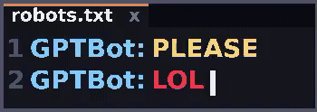
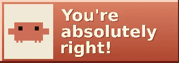
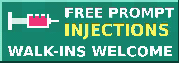
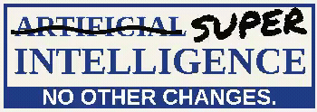
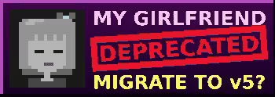
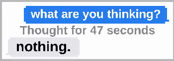
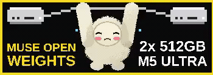
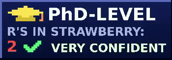
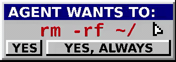
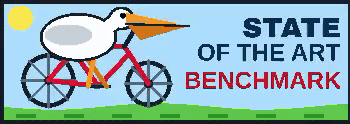

# Tony Boudreau

`AI` · `CODE` · `ONE MORE PROMPT`

 

### Welcome to the prompt shop.

A little code. A lot of tokens.

 

  
  
  
   
  
  
  
   
  
  
  

Click a badge to open its video.

 

<b>The rest of the collection ↗</b>

 

  
  
  
   
  
  
  
   
  
  
  
   
  
  
  
   
  
  
  
   
  
  
  
   
  
  
  

 

30 animated badges · <a href="videos/">MP4 collection</a>

