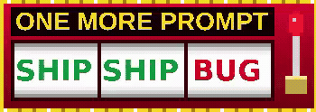
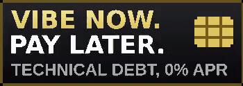
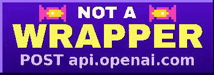
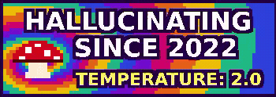
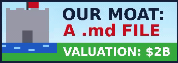
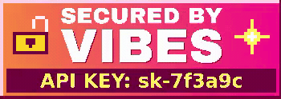
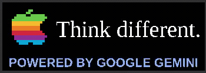
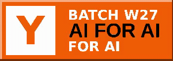
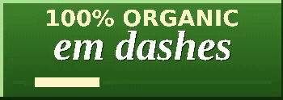
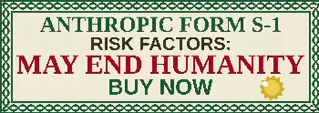

### hey, i'm tony.

Agentic engineer, based in Québec.

[website ↗](https://antoineboudreau.dev) · [projects ↗](https://github.com/dev-t0ny?tab=repositories)

  
  
  
  
  
  
   
  
  
  
  
  
  

